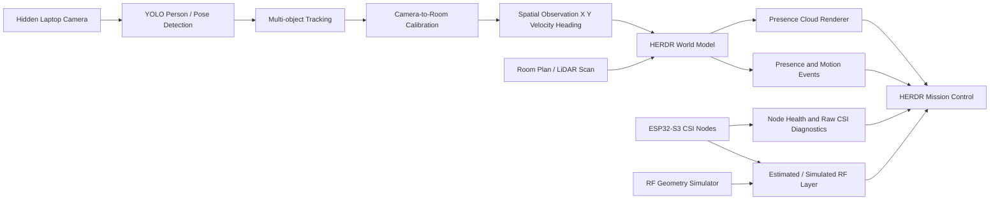
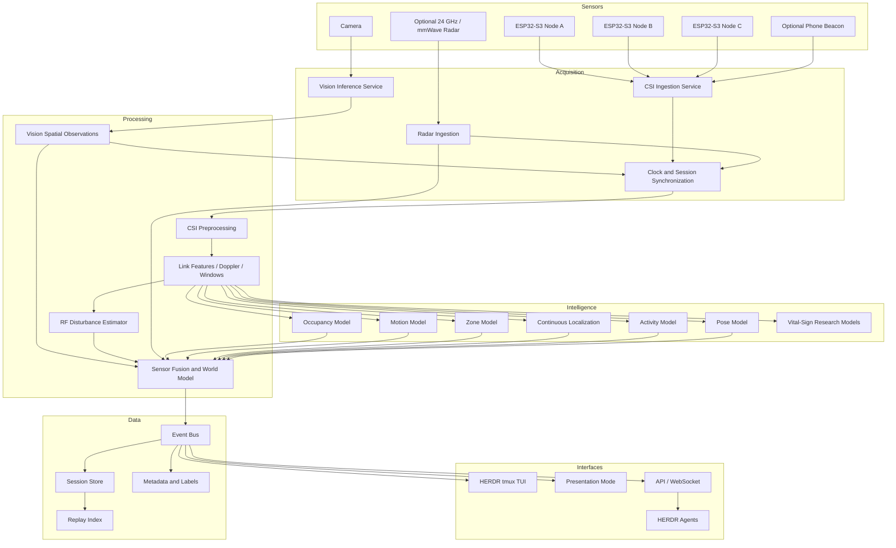
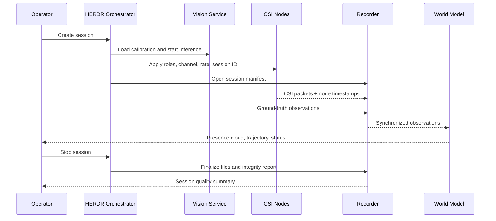

# HERDR Wi-Fi CSI Spatial Intelligence

## Product Landscape, Demonstration Architecture, Data Pipeline, and Development Roadmap

> **Project thesis:** use a hidden camera as a temporary ground-truth and localization sensor, use Wi-Fi CSI as the long-term privacy-preserving sensing modality, and expose only a unified spatial model: presence, motion, trajectory, room zones, RF disturbance, confidence, and system state.

---

## 1. Executive Summary

HERDR is being developed as an indoor spatial-intelligence platform that combines:

- Wi-Fi Channel State Information (CSI);
- hidden computer vision used for calibration and ground truth;
- a room plan or LiDAR-derived spatial model;
- optional mmWave radar;
- synchronized recording, training, evaluation, and replay;
- an operator interface running inside the HERDR `tmux` workspace.

The immediate presentation-ready product does **not** need to expose a raw camera feed. The camera can remain completely hidden and produce only structured spatial observations. A tracked person should appear on the room plan as a probabilistic, radar-like **presence cloud** with direction, velocity, confidence, and a decaying motion trail.

At the same time, the room plan can show a visually compelling Wi-Fi layer composed of transmitter/receiver paths, wave contours, Fresnel-inspired regions, wall attenuation, and interference patterns. Until the CSI pipeline is genuinely estimating these properties, the layer must be clearly marked as **simulated** or **estimated** rather than measured.

The most important research and implementation reference is [MM-Fi](https://github.com/ybhbingo/MMFi_dataset), because its multimodal structure closely matches the intended HERDR architecture: synchronized Wi-Fi CSI, vision/depth-derived labels, LiDAR, mmWave, position, pose, and action annotations. The most important firmware starting point for the existing ESP32-S3 hardware is the official [Espressif ESP-CSI](https://github.com/espressif/esp-csi) repository.

### Core development strategy

1. **Demonstrate the product experience now** using hidden camera localization and an honest simulated/estimated RF visualization.
2. **Record camera-derived ground truth and CSI synchronously** from every experiment.
3. Train progressively from easy, robust tasks toward harder ones:
   - occupied vs empty;
   - static vs moving;
   - room-zone classification;
   - grid-cell localization;
   - continuous `X,Y` localization;
   - activity recognition;
   - pose estimation;
   - respiration and heart-rate experiments.
4. Gradually reduce dependence on the camera during inference while keeping it available as a teacher, validator, and fallback sensor.

---

## 2. Product Vision

### 2.1 What the end user should experience

The end user sees a top-down room plan rather than surveillance video. On the plan, HERDR renders:

- active sensing nodes;
- current room occupancy;
- one or more presence clouds;
- movement direction and speed;
- recent trajectories;
- occupied zones;
- signal paths and disturbances;
- confidence and uncertainty;
- alerts and high-level events;
- optional health-related signals when technically validated.

The system should feel like a radar or tactical spatial console rather than a camera-monitoring interface.

### 2.2 Long-term product objective

The long-term objective is a device-free, privacy-preserving spatial sensing system that can operate:

- without requiring a wearable;
- without showing identifiable imagery;
- without requiring direct line of sight;
- with low-cost wireless nodes;
- with a reusable room-calibration and training process;
- with enough confidence information to communicate uncertainty honestly.

### 2.3 Product claims that must remain separated

HERDR must distinguish four different data states:

| State | Meaning | UI label |
|---|---|---|
| **Measured** | Directly obtained from a sensor or computed from measured samples with a validated algorithm | `MEASURED` |
| **Inferred** | Predicted by a trained model from measured data | `INFERRED` |
| **Estimated** | Generated from geometry, interpolation, or an incomplete physical model | `ESTIMATED` |
| **Simulated** | Synthetic presentation data used to illustrate the intended product behavior | `SIMULATED` |

A presentation can combine these states, but it must not imply that simulated RF contours are a true reconstruction of the electromagnetic field.

---

## 3. Immediate Demonstration Product: Hidden-Camera Spatial Radar

## 3.1 Demonstration objective

Build a convincing real-time spatial-intelligence experience while the full CSI stack is still under development.

The camera is used internally, but raw video is completely hidden. Only processed observations enter the world model.



### Visual concept


> **Concept-art warning:** the current artwork is a presentation reference, not a measurement screenshot. Its `5 GHz` node labels must be changed to `2.4 GHz` for the present ESP32-S3/StickS3 hardware. RF contours must also carry `SIMULATED`, `ESTIMATED`, or `MEASURED` provenance labels as defined in this specification.

## 3.2 Camera processing pipeline

Recommended initial stack:

- [Ultralytics](https://github.com/ultralytics/ultralytics) for YOLO detection, segmentation, or pose;
- [ByteTrack](https://github.com/ifzhang/ByteTrack) or the tracker integrated into the chosen Ultralytics pipeline;
- [OpenCV](https://github.com/opencv/opencv) for camera calibration, homography, geometry, and coordinate conversion;
- a small HERDR spatial adapter that emits a stable internal observation schema.

The raw image should be consumed inside a restricted vision process and not forwarded to the presentation interface.

### Minimum output per tracked person

```json
{
  "track_id": "P-01",
  "timestamp_ns": 1786022212345678900,
  "position_m": {"x": 3.42, "y": 2.18, "z": 0.0},
  "velocity_mps": 0.71,
  "heading_deg": 42.0,
  "zone": "living_area",
  "motion_state": "walking",
  "presence_confidence": 0.94,
  "position_covariance": [[0.08, 0.01], [0.01, 0.12]],
  "source": "vision",
  "source_state": "measured_and_transformed"
}
```

## 3.3 Presence cloud visual model

The person should not appear as a bounding box, photograph, or realistic body. HERDR should render a probabilistic volumetric mark that communicates presence without identity.

### Recommended visual encoding

- **Cloud center:** current estimated floor position.
- **Cloud width and height:** spatial uncertainty derived from detector confidence, calibration error, viewing angle, and tracker stability.
- **Opacity:** presence confidence.
- **Color intensity:** recency and motion energy.
- **Elongation:** velocity vector and direction of travel.
- **Trailing particles:** recent trajectory with exponential decay.
- **Outer halo:** uncertainty boundary or confidence interval.
- **Pulse rate:** current motion intensity, not heartbeat unless a real biometric model is active.
- **Zone glow:** optional subtle highlight of the currently occupied room zone.

A stationary person should form a compact, slowly breathing-looking cloud. A walking person should create an elongated cloud with a fading tail. Rapid motion should increase trail length and temporal blur.

### Conceptual renderer

For position mean `μ = (x, y)` and covariance `Σ`, the base spatial density can be represented as a two-dimensional Gaussian:

```text
presence(x, y) ∝ exp(-0.5 · (p - μ)ᵀ Σ⁻¹ (p - μ))
```

The renderer does not need to expose the equation, but using a real probability distribution gives the cloud meaningful behavior rather than decorative animation.

## 3.4 Camera-to-room localization

For a fixed camera observing a mostly planar floor, the MVP should use a calibrated homography:

```text
camera pixel coordinate (u, v)
        ↓ homography H
room coordinate (x, y) in meters
```

Use the lower-center point of the person box or an ankle/foot keypoint as the contact point. Pose keypoints are preferable when visible.

Calibration procedure:

1. Define the room coordinate origin and axes on the floor plan.
2. Place at least four well-separated reference points on the floor.
3. Record their pixel coordinates in the camera image.
4. Record their room coordinates in meters.
5. Solve and save the homography.
6. Validate using additional points not used in calibration.
7. Store calibration error and propagate it into the presence-cloud covariance.

## 3.5 Presentation-safe RF visualization

The RF layer should initially contain two parts.

### Static geometry layer

Derived from the room plan and node positions:

- node markers;
- direct transmitter-receiver paths;
- approximate Fresnel-zone envelopes;
- wall intersections;
- material-based attenuation assumptions;
- reflected path illustrations;
- smooth contour animation.

This layer is **simulated**.

### Live disturbance layer

Derived from whatever measurements are already stable:

- RSSI;
- CSI amplitude variance;
- packet rate;
- link stability;
- motion-energy score;
- per-link baseline deviation.

This layer can be **measured** or **inferred**, depending on the implementation.

### Required presentation labels

```text
LOCALIZATION SOURCE: VISION
RF GEOMETRY: SIMULATED
CSI DISTURBANCE: MEASURED        # only when genuinely connected
FUSION MODE: DEMO / HYBRID
RAW CAMERA: HIDDEN
```

---

## 4. Target HERDR Architecture



---

## 5. HERDR Internal Product Modules

HERDR should be treated as a suite of cooperating products rather than one monolithic application.

| Product module | Primary responsibility | Immediate state | Long-term state |
|---|---|---|---|
| **HERDR Mission Control** | Main operator and presentation interface | Camera-derived presence cloud and simulated RF | Unified multimodal world model |
| **Camera Teacher** | Hidden ground truth, localization, pose, labels | Primary localization source | Training/validation/fallback only |
| **Spatial Calibration Studio** | Align plan, camera, sensors, zones, and coordinate frames | Homography and node placement | Multi-camera / 3D calibration |
| **CSI Node Runtime** | Capture and transmit CSI and health telemetry | ESP32-S3 acquisition | OTA, schedules, edge models |
| **RF Field Renderer** | Visualize geometry, links, measured disturbances, and inferred fields | Simulated geometry + live node health | CSI-conditioned field estimate |
| **Fusion World Model** | Maintain people, devices, trajectories, zones, and confidence | Vision-led | CSI-led multimodal tracking |
| **Dataset Recorder** | Synchronized sessions, labels, manifests, and integrity checks | Essential | Autonomous continuous learning loop |
| **Training Lab** | Preprocessing, models, experiment tracking, evaluation | Baselines | Cross-room and self-supervised learning |
| **Replay Lab** | Time-synchronized review of observations and CSI | Required for debugging | Comparative model evaluation |
| **Device Manager** | Firmware, node roles, channel, sampling, status, OTA | Basic node control | Fleet operations |
| **Agent Console** | Coordinate HERDR agents and explain structured events | Operational support | Natural-language spatial analyst |
| **Phone Beacon** | Optional cooperative phone localization | Future experimental track | Device-person association and calibration |

---

## 6. HERDR `tmux` TUI: Screens and Panels

The TUI should be built as an operating environment for the entire sensing system. A practical Python implementation can use [Textual](https://github.com/Textualize/textual), [Rich](https://github.com/Textualize/rich), and terminal plotting tools such as [plotext](https://github.com/piccolomo/plotext), orchestrated inside [tmux](https://github.com/tmux/tmux).

## 6.1 Recommended `tmux` windows

```text
0:mission       Presentation-safe Mission Control
1:sensors       Camera teacher, CSI links, radar, phone beacon health
2:rf            Raw CSI, amplitude, phase, variance, Doppler, link matrix
3:spatial       Floor-plan calibration, zones, node placement, coordinates
4:record        Session recorder, labels, manifests, quality checks
5:replay        Synchronized replay and comparison
6:train         Training jobs, metrics, checkpoints, evaluations
7:devices       Firmware, node configuration, OTA, network
8:agents        HERDR agent status, queues, tasks, decisions
9:logs          Aggregated structured logs and alerts
```

## 6.2 Screen inventory

### 1. Mission Control

The default product screen.

Panels:

- central top-down room plan;
- presence cloud and trajectory;
- node positions and link lines;
- RF layer status;
- occupancy and motion state;
- current zone;
- confidence and latency;
- active alerts;
- recording indicator;
- sensor-fusion status.

### 2. Presentation Mode

A reduced, highly polished version of Mission Control:

- no raw video;
- no low-level debug noise;
- one dominant room map;
- large, readable presence state;
- live movement trail;
- elegant RF contours;
- clear source labels: `VISION`, `CSI`, `SIMULATED`, `INFERRED`;
- stable fallback behavior if a sensor disconnects.

### 3. Presence Radar

Focuses on people and movement:

- current target list;
- presence clouds;
- covariance/uncertainty;
- direction and velocity;
- motion energy;
- zone transitions;
- recent path;
- dwell time;
- last-seen timestamp.

### 4. RF Field

Focuses on room-scale radio visualization:

- room geometry;
- active link paths;
- baseline path loss;
- per-link disturbance;
- field contours;
- Fresnel-inspired envelopes;
- wall crossings;
- reflection illustrations;
- legend separating simulated geometry from measured disturbance.

### 5. CSI Monitor

Low-level signal view:

- amplitude per subcarrier;
- phase where usable;
- selected-subcarrier traces;
- packet rate;
- RSSI and noise floor;
- missing-packet rate;
- sample-window status;
- baseline deviation;
- motion-energy score;
- optional Doppler waterfall.

### 6. Sensor Fusion

Shows how each modality contributes:

```text
Vision localization        0.94
CSI occupancy              0.82
CSI movement               0.76
Map constraints            0.99
Radar presence             unavailable
Final fused confidence     0.91
```

It should also show why the final state was selected and whether any modality disagrees.

### 7. Floor Map and Calibration

- import plan, DXF-derived raster, or LiDAR projection;
- define origin, scale, and axes;
- place nodes and camera;
- draw camera field of view;
- create zones;
- enter wall/material metadata;
- add calibration points;
- inspect reprojection error;
- lock a validated calibration version.

### 8. Camera Teacher Diagnostics

This is an operator-only screen and must not be part of the public demo.

- optional raw image preview;
- detections and tracks;
- pose keypoints;
- foot/contact point;
- pixel-to-room projection;
- tracking continuity;
- confidence and occlusion warnings;
- privacy/storage state.

### 9. Tracking Table

```text
ID     X      Y      SPEED   HEADING   ZONE          STATE      CONF  LAST SEEN
P-01   3.42   2.18   0.71    42°       living_area   walking    .94   12 ms
```

### 10. Biometrics

Only show data that is actually produced by an active model. Every row needs a maturity badge.

```text
Respiration      EXPERIMENTAL / UNAVAILABLE / MEASURED
Heart rate       RESEARCH ONLY
Motion energy    MEASURED
Fall event       INFERRED
```

Do not animate synthetic ECG or display fabricated heart rate as a live measurement.

### 11. Recording

- session name and ID;
- room/calibration version;
- subject ID or anonymous participant code;
- active sensors;
- target action/trajectory;
- start, pause, stop;
- elapsed duration;
- frames and CSI packets;
- dropped samples;
- clock drift;
- disk usage;
- current labels;
- data-quality score.

### 12. Dataset Browser

- sessions;
- room;
- date;
- participants;
- actions;
- trajectories;
- active sensors;
- duration;
- sample count;
- labels;
- quality status;
- train/validation/test assignment.

### 13. Annotation and Ground Truth

- activity label;
- zone label;
- trajectory label;
- pose state;
- phone carried/not carried;
- occlusion markers;
- invalid intervals;
- automatic YOLO labels;
- human corrections.

### 14. Training

- job queue;
- model type;
- dataset version;
- split strategy;
- epoch/step;
- loss;
- validation metrics;
- GPU/CPU utilization;
- checkpoint path;
- failure reason;
- experiment notes.

### 15. Evaluation

- occupancy precision/recall/F1;
- motion classification metrics;
- zone confusion matrix;
- median and 90th percentile localization error;
- trajectory continuity;
- latency;
- cross-session performance;
- cross-person performance;
- cross-room performance;
- camera-vs-CSI discrepancy.

### 16. Replay

Synchronized timeline for:

- hidden-camera observations;
- CSI windows;
- node status;
- model predictions;
- fused world state;
- events;
- ground truth;
- alternative model outputs.

### 17. Device Manager

```text
NODE   ROLE   CHIP       CHANNEL   FW        IP           RSSI   RATE   STATUS
A      TX     ESP32-S3   6/HT20    0.3.1     10.0.0.31    -39    100Hz  READY
B      RX     ESP32-S3   6/HT20    0.3.1     10.0.0.32    -42    96Hz   READY
C      RX     ESP32-S3   6/HT20    0.3.1     10.0.0.33    -45    94Hz   READY
```

### 18. Firmware and OTA

- build identifier;
- ESP-IDF version;
- target board;
- channel and bandwidth;
- CSI configuration;
- packet scheduler;
- serial/network output;
- flash;
- OTA;
- rollback;
- reboot;
- per-node logs.

### 19. Network

- UDP/WebSocket/MQTT or internal bus status;
- throughput;
- packet loss;
- latency;
- clock offset;
- Tailscale status if used;
- node address resolution;
- service health.

### 20. Agent Console

Recommended agents:

- coordinator;
- firmware agent;
- vision agent;
- calibration agent;
- CSI preprocessing agent;
- recorder agent;
- dataset-quality agent;
- training agent;
- evaluation agent;
- presentation agent;
- incident/debugging agent.

### 21. Logs and Alerts

Structured streams by component:

```text
VISION  CSI  FUSION  RECORDER  TRAINING  DEVICE  NETWORK  AGENT  SYSTEM
```

---

## 7. External Product and Repository Landscape

The following products and research repositories are the most relevant items identified through [Awesome-WiFi-CSI-Sensing](https://github.com/NTUMARS/Awesome-WiFi-CSI-Sensing) and related primary sources.

## 7.1 Awesome-WiFi-CSI-Sensing

**Repository:** [NTUMARS/Awesome-WiFi-CSI-Sensing](https://github.com/NTUMARS/Awesome-WiFi-CSI-Sensing)

**Role:** continuously maintained research index covering occupancy, activity, identification, counting, gestures, fall detection, vital signs, pose, localization, multimodal sensing, CSI platforms, datasets, and public code.

**HERDR use:**

- research backlog;
- source of baselines and comparative methods;
- discovery of datasets and code;
- evidence map for future claims.

**Decision:** keep as the canonical external research index, but do not attempt to integrate everything listed there.

---

## 7.2 Espressif ESP-CSI — Primary Firmware Foundation

**Repository:** [espressif/esp-csi](https://github.com/espressif/esp-csi)

**Official ESP32-S3 CSI documentation:** [ESP-IDF Wi-Fi CSI guide](https://docs.espressif.com/projects/esp-idf/en/latest/esp32s3/api-guides/wifi.html)

**Why it matters:** this is the official Espressif project for applications based on Wi-Fi CSI. It explicitly lists the ESP32-S3 among supported chips and provides acquisition examples and human-presence/motion examples.

Relevant examples include:

- CSI receiver;
- CSI sender;
- router-assisted CSI collection;
- analysis tools;
- radar/presence demonstrations;
- on-site training workflows in newer sensing examples.

**HERDR use:**

- primary firmware base for the three ESP32-S3 nodes;
- reference for supported CSI APIs;
- sender/receiver packet generation;
- console diagnostics;
- future on-device presence models;
- OTA-compatible production direction.

**Decision:** **adopt first**.

---

## 7.3 ESP32 CSI Toolkit — Reference and Utility Source

**Repository:** [StevenMHernandez/ESP32-CSI-Tool](https://github.com/StevenMHernandez/ESP32-CSI-Tool)

**Project page:** [ESP32 CSI Toolkit](https://stevenmhernandez.github.io/ESP32-CSI-Tool/)

The toolkit provides:

- active station mode;
- active access-point mode;
- passive receiver mode;
- serial streaming;
- optional microSD recording;
- CSV output;
- Python visualization utilities;
- host-side timestamp appending.

**HERDR use:**

- study its role separation and packet-flow design;
- reuse or adapt host-side parsers and visualization ideas;
- compare active and passive collection strategies;
- use its timestamping approach as a baseline.

**Important limitation:** the repository targets an older ESP-IDF version and was primarily tested on classic ESP32 boards. It should not be assumed to work unchanged on M5Stack ESP32-S3 devices.

**Decision:** use as a **reference and source of utilities**, not as the default S3 firmware base.

---

## 7.4 Android CSI Labelling App

**Repository:** [StevenMHernandez/Android-CSI-Labelling-App](https://github.com/StevenMHernandez/Android-CSI-Labelling-App)

**Purpose:** records and labels CSI samples in real time using timer, press-and-hold, toggle, or manual labels.

**HERDR use:**

- reference for experiment-control UX;
- optional manual label input;
- fallback labelling tool when camera ground truth is unavailable;
- inspiration for a future mobile experiment controller.

**HERDR improvement:** the Camera Teacher should automatically generate richer labels, including position, trajectory, zone, motion state, and pose. Manual labels remain useful for experiment intent and corrections.

**Decision:** optional supporting tool; do not make it the center of the data workflow.

---

## 7.5 MM-Fi — Primary Multimodal Architecture Reference

**Repository:** [ybhbingo/MMFi_dataset](https://github.com/ybhbingo/MMFi_dataset)

**Project page:** [MM-Fi Dataset](https://ntu-aiot-lab.github.io/MMFi/)

MM-Fi provides a toolbox for a large synchronized multimodal dataset containing Wi-Fi CSI and complementary sensing modalities. Its repository describes more than 320,000 synchronized frames, 40 subjects, four environmental domains, 27 activity categories, and annotations that include:

- 2D and 3D human pose keypoints;
- 3D person position;
- dense pose;
- activity category.

The data loader supports individual modalities and combined modalities such as `wifi-csi|mmwave`, with frame-level or sequence-level samples.

**HERDR use:**

- model the session directory and manifest structure;
- align CSI windows with camera-derived labels;
- define a multimodal dataloader interface;
- define cross-domain splits;
- benchmark fusion approaches;
- use pose and position annotations as the conceptual target for HERDR labels.

**Decision:** **primary dataset and architecture reference**.

---

## 7.6 SenseFi — Baseline Training and Model Zoo

**Repository:** [xyanchen/WiFi-CSI-Sensing-Benchmark](https://github.com/xyanchen/WiFi-CSI-Sensing-Benchmark)

SenseFi is a PyTorch benchmark and library that evaluates multiple model families across public Wi-Fi CSI datasets. Its model set includes:

- MLP;
- LeNet;
- ResNet variants;
- RNN;
- GRU;
- LSTM and BiLSTM;
- CNN+GRU;
- Vision Transformer;
- supervised and self-supervised workflows.

**HERDR use:**

- training-code baseline;
- reusable dataset/model abstractions;
- simple activity-recognition benchmarks;
- sanity checks for HERDR preprocessing;
- comparison of lightweight and heavier architectures.

**Limitation:** SenseFi is primarily a benchmark for classification tasks, not a ready-made continuous room-coordinate estimator.

**Decision:** adopt as the first external ML benchmark, then wrap it behind HERDR-native datasets and metrics.

---

## 7.7 SHARP — Signal Processing and Doppler Reference

**Repository:** [francescamen/SHARP](https://github.com/francescamen/SHARP)

SHARP provides reference code for environment- and person-independent activity recognition using an 802.11ac setup with Nexmon CSI. The repository includes:

- phase sanitization;
- channel reconstruction;
- Doppler computation;
- sliding-window processing;
- plotting;
- training and evaluation.

**HERDR use:**

- study phase-cleaning methodology;
- adapt Doppler-spectrum concepts;
- build motion-energy and activity features;
- design RF diagnostic panels;
- compare amplitude-only and phase-aware paths.

**Limitation:** the published setup uses a commercial 5 GHz, 80 MHz router and Nexmon CSI. The code is not directly portable to an ESP32-S3 2.4 GHz CSI stream.

**Decision:** use as a **signal-processing reference**, not a drop-in component.

---

## 7.8 WiSPPN / “Can WiFi Estimate Person Pose?”

**Repository:** [geekfeiw/WiSPPN](https://github.com/geekfeiw/WiSPPN)

**Paper:** [Can WiFi Estimate Person Pose?](https://arxiv.org/abs/1904.00277)

The repository contains a single-person Wi-Fi pose-estimation example, preprocessing code, model code, and a pretrained-model workflow.

**HERDR use:**

- understand pose-output representation;
- study CSI-to-keypoint model design;
- use as a long-term research reference;
- compare a future HERDR pose output against established work.

**Limitations:**

- research-era setup;
- specialized data and antenna/camera system;
- not designed for ESP32-S3 streams;
- not appropriate as the first implementation milestone.

**Decision:** reference only until occupancy, movement, zone, and localization are stable.

---

## 7.9 EfficientFi — Future Edge/Cloud Compression

**Repository:** [NTU-AIoT-Lab/EfficientFi](https://github.com/NTU-AIoT-Lab/EfficientFi)

EfficientFi combines:

- an encoder at the edge;
- quantization;
- cloud-side reconstruction;
- a joint classifier.

The project is intended to reduce CSI communication overhead while preserving sensing utility.

**HERDR use:**

- future multi-room deployments;
- compressed CSI or feature transport through Tailscale;
- edge/cloud split inference;
- fleet-scale bandwidth reduction;
- latent representations for privacy and storage reduction.

**Decision:** defer until raw data collection and baseline models are stable.

---

## 7.10 Nexmon CSI — Higher-Fidelity Alternative Backend

**Repository:** [seemoo-lab/nexmon_csi](https://github.com/seemoo-lab/nexmon_csi)

Nexmon CSI extracts CSI from supported Broadcom Wi-Fi chips and can operate with higher channel bandwidth than the ESP32-S3 platform. Supported devices include specific phones, Raspberry Pi variants, and compatible routers.

**HERDR use:**

- optional higher-fidelity research backend;
- reproduce or adapt SHARP-like pipelines;
- compare 2.4 GHz ESP32 data against 5 GHz/80 MHz CSI;
- validate whether hardware limitations, rather than models, are blocking performance.

**Decision:** not required for the first demo, but it is the strongest upgrade path for serious phase/Doppler experiments.

---

## 7.11 Wi-Chat — LLM Interpretation Layer

**Paper:** [Wi-Chat: Large Language Model Powered Wi-Fi Sensing](https://arxiv.org/abs/2502.12421)

Wi-Chat explores LLM-guided interpretation of Wi-Fi CSI and reports zero-shot activity-recognition experiments using physical Wi-Fi sensing knowledge in prompts.

**HERDR use:**

- future operator explanations;
- natural-language summaries of structured spatial events;
- exploratory reasoning over precomputed signal features;
- agent assistance during experiment analysis.

**Important boundary:** the production system should not ask an LLM to replace deterministic acquisition, synchronization, preprocessing, tracking, or safety-critical classification. The LLM should consume structured observations and validated model outputs.

**Decision:** research and explanation layer only, after numeric models are operational.

---

## 7.12 Supporting Public Datasets

The Awesome repository also links datasets useful for pretraining and pipeline verification:

- **NTU-Fi:** activity recognition and human identification;
- **UT-HAR:** continuous CSI for six activities;
- **Widar 3.0:** large gesture-recognition dataset across many domains;
- **WiAR:** coarse activities and gestures;
- **SignFi:** sign-language CSI traces;
- **WiFi-80MHz:** wider-band CSI collected with commercial routers.

**HERDR use:** verify dataloaders, reproduce known baselines, test general model code, and study cross-domain evaluation. These datasets cannot replace HERDR’s room-specific synchronized recordings because their hardware, geometry, sampling, subjects, and labels differ from the target deployment.

---

## 8. Product Selection Matrix

| Product | Use now | Use later | Main value | Main limitation | HERDR decision |
|---|---:|---:|---|---|---|
| Espressif `esp-csi` | Yes | Yes | Official S3 CSI foundation | Requires custom integration and validation | Primary firmware base |
| ESP32 CSI Toolkit | Partial | Partial | Active/passive patterns, CSV, utilities | Old IDF and classic-ESP32 orientation | Reference/port utilities |
| Android CSI Labelling App | Optional | Optional | Manual labels and experiment UX | Less rich than automatic vision labels | Supporting tool |
| MM-Fi | Yes | Yes | Multimodal schema and benchmark architecture | Different hardware and environments | Primary research template |
| SenseFi | Yes | Yes | Baseline model zoo | Mostly classification | First ML benchmark |
| SHARP | Reference | Yes | Phase and Doppler pipeline | Nexmon 5 GHz/80 MHz-specific | Adapt concepts only |
| WiSPPN | No | Research | CSI-to-pose example | Specialized old research stack | Long-term reference |
| EfficientFi | No | Yes | Edge/cloud CSI compression | Premature before stable pipeline | Scale-stage component |
| Nexmon CSI | No | Optional | Higher-bandwidth research CSI | Additional compatible hardware required | Upgrade path |
| Wi-Chat | No | Research | LLM interpretation | Not a replacement for validated models | Agent/explanation layer |

---

## 9. Recommended Hardware and Node Topology

## 9.1 Existing hardware reality

The M5Stack StickS3 uses the ESP32-S3 and supports **2.4 GHz Wi-Fi**, not 5 GHz. The ESP32-S3 supports 802.11 b/g/n with up to 40 MHz channel bandwidth.

Therefore:

- any HERDR concept screen showing `5 GHz` for the current StickS3 nodes is a visual placeholder and must be corrected;
- SHARP’s 5 GHz/80 MHz results cannot be expected from the current hardware;
- the current nodes do not form an antenna array, so direct Angle of Arrival imaging is not available;
- an external-antenna ESP32-S3 board may provide more stable and controllable RF behavior than a compact internal antenna.

Official references:

- [ESP32-S3 product page](https://www.espressif.com/en/products/socs/esp32-s3)
- [M5Stack StickS3 documentation](https://docs.m5stack.com/en/core/StickS3)

## 9.2 Recommended initial three-node configuration

For stable acquisition, begin with fixed roles:

```text
Node A: dedicated packet transmitter / controlled sender
Node B: CSI receiver
Node C: CSI receiver
Laptop: clock authority, recorder, camera teacher, world model, TUI
```

This gives two simultaneous spatial links and avoids disruptions from rapid role switching.

### Why not rotate transmitter roles immediately

Round-robin transmitter operation is useful for increasing spatial diversity, but frequent role changes can introduce:

- gaps in sampling;
- channel/reassociation delays;
- timing ambiguity;
- different transmitter power and antenna patterns;
- harder synchronization;
- inconsistent windows during a live demo.

Recommended sequence:

1. fixed roles for the presentation and initial dataset;
2. role rotation between recording runs;
3. synchronized scheduled rotation only after the fixed-role pipeline is stable;
4. eventually use additional nodes so several links are observed concurrently.

## 9.3 Router requirements

A router is optional for certain controlled sender/receiver designs, but it can simplify network connectivity and host communication. It should not be confused with the sensing transmitter unless the acquisition design explicitly uses router replies as CSI packets.

For the current MVP, prioritize:

- fixed channel;
- minimal automatic channel changes;
- stable 2.4 GHz operation;
- isolated test SSID;
- low competing traffic;
- known transmitter and receiver MAC addresses.

---

## 10. Data Acquisition and Processing Pipeline

## 10.1 Session lifecycle



## 10.2 CSI ingestion stages

1. Receive node packet.
2. Validate node ID, sequence number, payload length, and checksum.
3. Attach host receive timestamp.
4. Estimate or record node-to-host clock offset.
5. Decode CSI complex samples.
6. Store the untouched raw record.
7. Compute quick live diagnostics.
8. Buffer records into fixed-duration windows.
9. Run offline or online preprocessing.
10. Join windows with vision-derived labels.

## 10.3 Recommended preprocessing stages

Not every stage will be usable immediately, especially phase-sensitive stages on commodity low-cost hardware.

- packet-quality filtering;
- invalid-subcarrier removal;
- amplitude extraction;
- optional phase extraction and sanitization;
- per-link normalization;
- static baseline subtraction;
- outlier removal;
- missing-packet handling;
- resampling to a stable time grid;
- low-pass / band-pass filters by task;
- sliding windows;
- amplitude variance and correlation;
- PCA or learned dimensionality reduction;
- short-time Fourier transform for motion/Doppler-like features;
- link aggregation;
- quality mask propagated into the model.

## 10.4 Time synchronization

Every observation must contain:

- node timestamp;
- host receive timestamp;
- monotonically increasing sequence number;
- session ID;
- optional synchronized experiment clock.

The host computer should be the primary session clock for the MVP. The camera and serial/network CSI data must be timestamped as close to acquisition as possible.

Do not rely only on wall-clock timestamps printed by independent microcontrollers.

---

## 11. Unified HERDR Data Contract

## 11.1 Session manifest

```yaml
session_id: room01_2026-08-06_run004
schema_version: 1.0
room_id: room01
room_model_version: 3
calibration_version: 5
started_at_utc: 2026-08-06T14:25:10.235Z
operator: vladyka
purpose: zone_localization_baseline
privacy_mode: derived_vision_only
subjects:
  - subject_id: S001
    consent_ref: local-record
nodes:
  - node_id: A
    role: tx
    chip: esp32-s3
    channel: 6
    bandwidth_mhz: 20
    firmware: herdr-csi-0.3.1
  - node_id: B
    role: rx
    chip: esp32-s3
    channel: 6
    bandwidth_mhz: 20
    firmware: herdr-csi-0.3.1
  - node_id: C
    role: rx
    chip: esp32-s3
    channel: 6
    bandwidth_mhz: 20
    firmware: herdr-csi-0.3.1
labels:
  activity_protocol: walking_grid
  target_zones: [entry, living_area, table, sofa]
```

## 11.2 CSI record

```json
{
  "schema": "herdr.csi.v1",
  "session_id": "room01_2026-08-06_run004",
  "node_id": "B",
  "link_id": "A->B",
  "sequence": 123456,
  "node_time_us": 837223010,
  "host_time_ns": 1786022212345678900,
  "channel": 6,
  "bandwidth_mhz": 20,
  "rssi_dbm": -42,
  "noise_floor_dbm": -94,
  "csi_iq": [[-3, 11], [-4, 9], [0, 7]],
  "quality": {"valid": true, "dropped_before": 0}
}
```

## 11.3 Spatial observation

```json
{
  "schema": "herdr.spatial_observation.v1",
  "session_id": "room01_2026-08-06_run004",
  "timestamp_ns": 1786022212345678900,
  "entity_id": "P-01",
  "entity_type": "person",
  "x_m": 3.42,
  "y_m": 2.18,
  "z_m": 0.0,
  "vx_mps": 0.53,
  "vy_mps": 0.47,
  "heading_deg": 42,
  "zone": "living_area",
  "activity": "walking",
  "confidence": 0.94,
  "covariance_xy": [0.08, 0.01, 0.01, 0.12],
  "source": "camera_teacher"
}
```

## 11.4 Fused world-state event

```json
{
  "schema": "herdr.world_state.v1",
  "timestamp_ns": 1786022212345678900,
  "entities": [
    {
      "id": "P-01",
      "type": "person",
      "position": [3.40, 2.20, 0.0],
      "velocity": [0.51, 0.45, 0.0],
      "zone": "living_area",
      "state": "walking",
      "confidence": 0.91,
      "sources": {
        "vision": 0.94,
        "csi_presence": 0.82,
        "csi_motion": 0.76,
        "map_constraint": 0.99
      }
    }
  ]
}
```

---

## 12. Room Model and Coordinate System

Every room installation must produce a versioned spatial package:

```text
room_package/
├── room.yaml
├── plan.svg
├── plan.png
├── geometry.geojson
├── zones.geojson
├── nodes.yaml
├── camera_calibration.yaml
├── materials.yaml
└── validation_report.md
```

### Required room metadata

- dimensions in meters;
- coordinate origin;
- north/display orientation;
- wall polygons;
- doors and openings;
- major furniture or obstruction polygons;
- semantic zones;
- node positions and orientations;
- camera position, orientation, and field of view;
- calibration points;
- validation error;
- version and timestamp.

### Coordinate convention

Recommended:

```text
origin: lower-left corner of the plan
+x: right on the plan
+y: upward on the plan
+z: height above floor
units: meters
angles: degrees clockwise from +y, or another convention documented once and used everywhere
```

---

## 13. RF Field Visualization: Physical Meaning and Limits

## 13.1 What three ESP32-S3 nodes can realistically provide

With one controlled transmitter and two receivers, HERDR can obtain two link observations. It can detect changes in the propagation channel caused by movement, obstruction, and multipath changes.

This is enough to begin:

- occupancy detection;
- movement detection;
- coarse zone classification after training;
- trajectory inference when combined with temporal models and room constraints;
- a visual disturbance map conditioned on a small number of links.

## 13.2 What the system cannot directly reconstruct

Three compact single-antenna nodes do not directly measure the complete electromagnetic field at every point in the room. They do not provide a dense spatial RF image or true ray-by-ray reconstruction.

Therefore, the central RF visualization should be understood as a combination of:

```text
room geometry
+ node positions
+ propagation assumptions
+ measured per-link change
+ learned location likelihood
= visual RF/spatial estimate
```

## 13.3 Recommended RF rendering layers

1. **Node radiation illustration** — simulated.
2. **Direct-path and wall-intersection geometry** — calculated.
3. **Fresnel-inspired region** — calculated approximation.
4. **Background field contour** — simulated or model-estimated.
5. **Per-link live disturbance intensity** — measured feature.
6. **Presence likelihood map** — inferred by the model.
7. **Uncertainty layer** — inferred/model-derived.

The UI legend must identify each layer’s origin.

---

## 14. Training Roadmap

Training should progress by task difficulty. Trying to begin with 3D pose, heart rate, or centimeter-level localization would create unnecessary risk.

## Stage 0 — Signal integrity

Goal: prove that CSI is being captured consistently.

Outputs:

- packet rate;
- valid CSI shape;
- RSSI distribution;
- baseline stability;
- link differences when the room changes;
- repeatability across restarts.

## Stage 1 — Empty vs occupied

Goal: binary presence detection.

Labels:

```text
empty
occupied
```

This is the first model that should run live.

## Stage 2 — Static vs moving

Labels:

```text
empty
person_static
person_moving
```

This supports the first real CSI contribution to the presentation.

## Stage 3 — Zone classification

Divide the room into robust semantic zones:

```text
entry
left_side
center
right_side
sofa
work_area
```

Start with large zones rather than a dense grid.

## Stage 4 — Grid localization

Divide the floor into cells, initially around `0.5–1.0 m` in size. The model outputs a probability distribution over cells. Render this directly as a presence cloud.

## Stage 5 — Continuous `X,Y` localization

Model outputs:

- `x` and `y`;
- covariance or uncertainty;
- optional velocity;
- confidence.

A classification-plus-offset model may be more stable than direct unconstrained regression.

## Stage 6 — Activity recognition

Initial classes:

```text
walking
standing
sitting
lying
entering
leaving
fall_candidate
```

Use pose labels from the camera teacher, but merge visually similar or RF-ambiguous classes during early experiments.

## Stage 7 — Pose estimation

Only after a larger, diverse dataset exists. Begin with coarse body state or a small set of keypoints rather than full dense pose.

## Stage 8 — Respiration and heart-rate research

Treat these as separate signal-processing and modeling problems. Requirements include:

- stationary subject;
- stable placement;
- high and consistent packet rate;
- long observation windows;
- controlled orientation and distance;
- strong baseline removal;
- independent ground-truth sensor;
- explicit confidence and failure state.

Do not combine unvalidated respiratory or heart-rate output with the presentation’s trusted localization metrics.

---

## 15. Dataset Collection Protocol

## 15.1 Baseline sessions

Record:

- empty room, multiple durations;
- empty room with doors open/closed;
- empty room with common appliances active;
- static furniture configurations;
- each node restart and firmware version.

## 15.2 Single-person localization sessions

For each marked point or zone:

- stand facing multiple directions;
- stand at multiple body orientations relative to links;
- sit where applicable;
- repeat on different days;
- repeat after moving small objects;
- repeat with different participants.

## 15.3 Trajectory sessions

Predefine paths:

- straight line;
- diagonal;
- room perimeter;
- figure eight;
- enter and leave;
- pause at waypoints;
- random natural movement.

## 15.4 Activity sessions

- standing;
- sitting down;
- standing up;
- walking;
- bending;
- lying down;
- controlled fall-like movement only under safe conditions.

## 15.5 Data split policy

Avoid random frame-level splitting because adjacent frames from the same recording can leak nearly identical signal patterns into train and test sets.

Use splits by:

- recording session;
- day;
- participant;
- node placement;
- room configuration;
- eventually room.

Maintain at least:

```text
train: sessions and people used for fitting
validation: separate sessions for model selection
test: untouched sessions, preferably separate day and participant
```

---

## 16. Initial Evaluation Targets

These are proposed engineering acceptance targets, not current achieved results.

| Capability | Initial target | Notes |
|---|---:|---|
| CSI stream uptime | ≥ 95% during a 15-minute run | Excluding deliberate reconfiguration |
| Missing CSI records | < 5% | Report per link |
| Empty/occupied F1 | ≥ 0.95 in the calibrated room | Same-room baseline |
| Static/moving F1 | ≥ 0.90 | Same-room baseline |
| Large-zone accuracy | ≥ 0.85 | Start with 3–6 zones |
| Median `X,Y` error | ≤ 1.0 m for first regression MVP | Improve with more links/data |
| Vision-to-map median error | ≤ 0.20 m in visible floor area | Depends on camera geometry |
| World-state update rate | ≥ 10 Hz | Presentation target |
| End-to-end UI latency | ≤ 200 ms | Target, not guaranteed initially |
| Session timestamp drift | documented and bounded | Must be measured |

---

## 17. Phone Localization Product Track

A phone can be incorporated in three different ways.

## 17.1 Cooperative phone beacon

A phone application sends controlled UDP or other predictable packets. ESP32 receivers collect CSI associated with those packets.

Potential outputs:

- phone presence;
- link RSSI;
- coarse phone zone;
- learned `X,Y` location;
- phone-person proximity.

This is the most controllable approach.

## 17.2 Phone as ground-truth instrument

A phone can contribute:

- visual-inertial odometry;
- AR room coordinates;
- manually selected waypoints;
- timestamps and experiment labels.

It can then become another teacher for CSI localization.

## 17.3 Passive arbitrary phone detection

This is less reliable because phones may sleep, change traffic patterns, randomize addresses, switch channels, or not transmit enough packets. HERDR should not promise universal passive phone localization without a cooperative app or controlled network conditions.

## 17.4 Device-person association

The world model can compare person and phone probability distributions:

```text
P(phone carried by person) = function(
    spatial overlap,
    synchronized motion,
    temporal continuity,
    network identity confidence
)
```

The result should be probabilistic, not an absolute identity claim.

---

## 18. Demonstration Runbook

## 18.1 Before the presentation

- load a tested room package;
- lock camera position;
- verify homography with at least three visible check points;
- start YOLO and tracking;
- confirm stable world coordinates;
- start node health monitoring;
- use fixed TX/RX roles;
- verify room-map rendering;
- verify motion trail and cloud decay;
- set RF geometry label to `SIMULATED`;
- set CSI status truthfully;
- prepare a deterministic replay fallback.

## 18.2 Live sequence

1. Open Mission Control with an empty room.
2. Show `Presence: CLEAR`.
3. A person enters.
4. Presence cloud appears at the doorway.
5. The cloud moves across the room with a fading trail.
6. Zone changes are shown.
7. Direction and velocity update.
8. RF link disturbance or simulated field reacts visually.
9. The person stops; the cloud becomes compact.
10. The person exits; cloud fades and the event timeline records the transition.

## 18.3 Presentation language

Recommended statement:

> “The interface is sensor-agnostic. In this demonstration, the camera is used as a hidden localization and ground-truth sensor while the Wi-Fi CSI pipeline is being trained. The user never sees camera imagery—only a privacy-preserving spatial representation. The same world model will progressively replace vision-derived localization with Wi-Fi CSI inference, including non-line-of-sight scenarios.”

## 18.4 Fallback mode

Record one perfect synchronized run and allow Mission Control to replay it through the same event bus. The UI should not distinguish live and replay internally except for a clearly visible operator-only state.

Never claim replay data is live if asked directly.

---

## 19. Development Roadmap

## Phase A — Presentation Product

Deliverables:

- hidden YOLO camera process;
- stable tracking;
- room homography;
- presence cloud;
- motion trail;
- zone events;
- node status;
- simulated RF layer;
- presentation-safe Mission Control;
- recorded replay fallback.

## Phase B — Reproducible CSI Acquisition

Deliverables:

- official `esp-csi` fork for StickS3/ESP32-S3;
- fixed TX and two RX roles;
- packet scheduler;
- binary or structured packet protocol;
- host timestamps;
- session manifests;
- raw data integrity checks;
- live CSI diagnostics.

## Phase C — Camera-Teacher Dataset Factory

Deliverables:

- synchronized vision labels and CSI windows;
- automatic zones and activities;
- recording protocols;
- dataset browser;
- replay;
- versioned preprocessing;
- leakage-safe splits.

## Phase D — First CSI Intelligence

Deliverables:

- empty/occupied model;
- static/moving model;
- large-zone model;
- live confidence;
- CSI contribution visible in Fusion screen.

## Phase E — Localization

Deliverables:

- grid-likelihood model;
- probability-cloud rendering from CSI;
- continuous `X,Y` model;
- trajectory filter;
- map constraints;
- camera-vs-CSI evaluation.

## Phase F — Multimodal and Cross-Environment

Deliverables:

- radar integration;
- more nodes/links;
- role scheduling;
- cross-day robustness;
- cross-person evaluation;
- room adaptation;
- self-supervised pretraining.

## Phase G — Advanced Research

Deliverables:

- pose estimation;
- multiple people;
- phone-person association;
- respiration;
- heart-rate experiments;
- edge compression;
- camera-free deployment modes.

---

## 20. Risk Register and Technical Boundaries

| Risk | Impact | Mitigation |
|---|---|---|
| Old ESP32 toolkit does not build on S3 | Firmware delay | Base work on official `esp-csi`; port only useful patterns |
| CSI packet rate is unstable | Weak models and broken synchronization | Controlled sender, fixed channel, sequence numbers, buffering |
| Phase is noisy or unusable | SHARP-like pipeline cannot transfer directly | Begin with amplitude and robust link statistics |
| Three nodes provide too little spatial diversity | Poor localization | Add sessions with role changes, then add nodes or higher-fidelity hardware |
| Camera calibration drifts | Incorrect ground truth | Lock camera, version calibration, validate before every session |
| Dataset leakage inflates metrics | False confidence | Split by session/day/person, never random adjacent frames |
| RF visualization is mistaken for measurement | Credibility damage | Persistent `SIMULATED / ESTIMATED / MEASURED` labels |
| Internal antennas have directionality | Non-repeatable signals | Record orientation, use fixed mounts, consider external antennas |
| Furniture/environment changes degrade models | Poor generalization | Record domain variations and baseline updates |
| Heart-rate claims exceed hardware evidence | Product trust and safety risk | Keep as research-only until independently validated |
| Raw camera creates privacy concerns | Deployment resistance | Process locally, store derived labels by default, restrict diagnostics |
| LLM invents interpretation | Incorrect events | LLM reads structured outputs only; deterministic models remain authoritative |

---

## 21. Recommended Multi-Agent Work Breakdown

### Agent 1 — Firmware and node protocol

- fork `espressif/esp-csi`;
- confirm StickS3 target and pin/peripheral conflicts;
- implement sender and receiver roles;
- add node ID, sequence, timestamp, RSSI, CSI payload;
- implement configuration and health commands;
- document reproducible flashing.

### Agent 2 — Vision and tracking

- implement hidden YOLO pipeline;
- add stable tracking;
- choose floor contact point;
- emit spatial observations;
- expose no raw frames to Mission Control.

### Agent 3 — Spatial calibration

- import plan;
- define coordinates and zones;
- implement homography calibration;
- place sensors;
- validate error;
- version room package.

### Agent 4 — Recorder and data schema

- implement session manifest;
- ingest CSI and vision events;
- synchronize windows;
- write raw and derived stores;
- create integrity and quality report.

### Agent 5 — Mission Control / TUI

- implement room renderer;
- presence cloud;
- trail;
- RF geometry;
- sensor panels;
- truth-state labels;
- replay mode.

### Agent 6 — CSI preprocessing

- raw parser;
- amplitude/phase extraction;
- filtering;
- resampling;
- baseline features;
- window generation;
- diagnostic plots.

### Agent 7 — ML baselines

- integrate SenseFi-style models;
- train occupancy and motion baselines;
- implement zone classification;
- log metrics by split;
- export inference service.

### Agent 8 — Evaluation and QA

- define test sessions;
- verify no leakage;
- compare camera and CSI;
- report latency, packet loss, drift, and errors;
- block unsupported claims in presentation mode.

### Agent 9 — Research scout

- track relevant work from Awesome-WiFi-CSI-Sensing;
- maintain repository compatibility notes;
- prioritize reproducible code over papers without implementations;
- maintain the evidence map for future capabilities.

---

## 22. Recommended Repository Adoption Order

```text
1. espressif/esp-csi
2. ultralytics/ultralytics + OpenCV + tracker
3. HERDR room calibration and event schema
4. HERDR recorder and replay
5. MMFi dataset/toolbox concepts
6. SenseFi benchmark models
7. ESP32 CSI Toolkit utilities and patterns
8. SHARP preprocessing concepts
9. Nexmon CSI as an optional research upgrade
10. EfficientFi for scale
11. WiSPPN for pose research
12. Wi-Chat for explanation and agent interaction
```

---

## 23. Definition of Done

## Presentation product is done when

- raw video is not visible;
- a real person is localized on the plan;
- presence cloud movement is stable and visually coherent;
- zones and trajectories work;
- all data-source states are correctly labelled;
- the UI survives temporary node disconnection;
- a replay fallback exists;
- no fabricated biometric values are shown as measured.

## Data platform is done when

- one command creates a versioned session;
- camera and CSI records share a timebase;
- every sample can be traced to firmware, calibration, room, and preprocessing version;
- incomplete sessions are detected automatically;
- replay reproduces the same observations;
- train/validation/test splits are reproducible.

## First CSI MVP is done when

- empty/occupied and static/moving models meet agreed test metrics;
- results are evaluated on separate recording sessions;
- live inference contributes to the Fusion screen;
- confidence drops appropriately when the stream quality degrades;
- the camera can be disabled without crashing the CSI inference path.

---

## 24. Primary Links

### Research index

- [Awesome-WiFi-CSI-Sensing](https://github.com/NTUMARS/Awesome-WiFi-CSI-Sensing)

### ESP32 / CSI acquisition

- [Espressif ESP-CSI](https://github.com/espressif/esp-csi)
- [ESP32-S3 Wi-Fi CSI documentation](https://docs.espressif.com/projects/esp-idf/en/latest/esp32s3/api-guides/wifi.html)
- [ESP32-S3 product specifications](https://www.espressif.com/en/products/socs/esp32-s3)
- [M5Stack StickS3 documentation](https://docs.m5stack.com/en/core/StickS3)
- [ESP32 CSI Toolkit repository](https://github.com/StevenMHernandez/ESP32-CSI-Tool)
- [ESP32 CSI Toolkit website](https://stevenmhernandez.github.io/ESP32-CSI-Tool/)
- [Android CSI Labelling App](https://github.com/StevenMHernandez/Android-CSI-Labelling-App)
- [Nexmon CSI](https://github.com/seemoo-lab/nexmon_csi)

### Datasets, models, and research code

- [MM-Fi Toolbox and Dataset Repository](https://github.com/ybhbingo/MMFi_dataset)
- [MM-Fi Project Page](https://ntu-aiot-lab.github.io/MMFi/)
- [SenseFi / WiFi CSI Sensing Benchmark](https://github.com/xyanchen/WiFi-CSI-Sensing-Benchmark)
- [SHARP](https://github.com/francescamen/SHARP)
- [WiSPPN](https://github.com/geekfeiw/WiSPPN)
- [EfficientFi](https://github.com/NTU-AIoT-Lab/EfficientFi)
- [Wi-Chat paper](https://arxiv.org/abs/2502.12421)

### Vision and interface stack

- [Ultralytics](https://github.com/ultralytics/ultralytics)
- [ByteTrack](https://github.com/ifzhang/ByteTrack)
- [OpenCV](https://github.com/opencv/opencv)
- [Textual](https://github.com/Textualize/textual)
- [Rich](https://github.com/Textualize/rich)
- [plotext](https://github.com/piccolomo/plotext)
- [tmux](https://github.com/tmux/tmux)

---

## 25. Final Product Direction

HERDR should not be framed as “a YOLO demo” or “an ESP32 experiment.” It should be framed as a spatial-intelligence platform with a unified world model and replaceable sensing modalities.

The immediate implementation uses the camera because it provides reliable position and automatic labels. The strategic value comes from turning those labels into a continually growing synchronized CSI dataset. The same room plan, entity model, event bus, recorder, replay system, and Mission Control remain valid as the sensing source evolves from vision-led to CSI-led.

The strongest near-term product is therefore:

> **A privacy-preserving indoor radar interface that displays only processed spatial presence, while simultaneously using hidden vision to train and validate a Wi-Fi CSI sensing system.**

That product is demonstrable now, technically honest, useful as a dataset factory, and directly aligned with the long-term objective of camera-free and through-wall spatial sensing.
